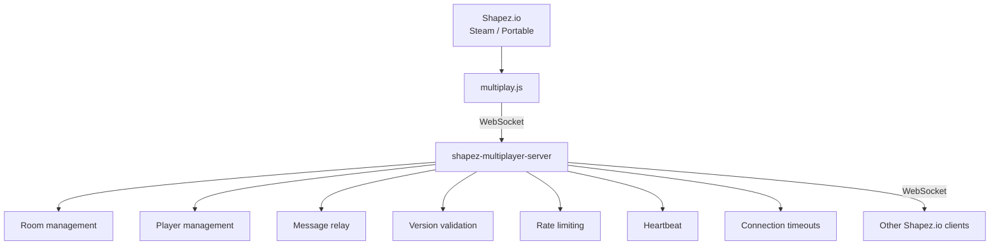
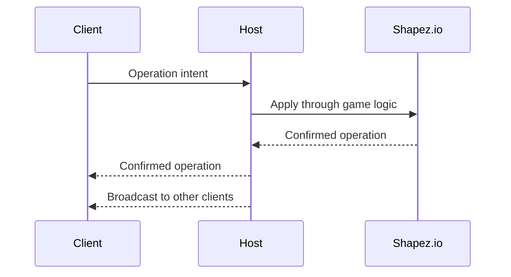
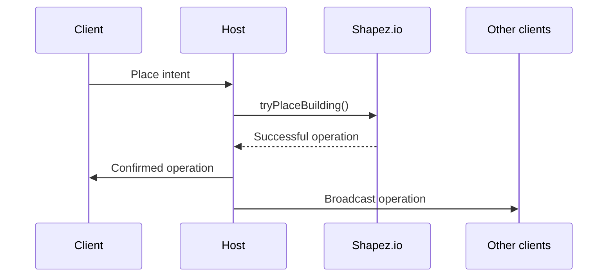

# Shapez Multiplayer

A multiplayer mod for [Shapez.io](https://shapez.io/) that allows multiple players to share and interact with the same world.

The project provides host-authoritative world synchronization over WebSocket and is designed to work with both the Steam and portable versions of Shapez.io.

> **Status:** Active development. Core networking and synchronization are implemented, but some real-world multiplayer scenarios are still being validated.

## Features

* Host-authoritative multiplayer
* WebSocket-based networking
* Steam and portable Shapez.io support
* Multiplayer sessions for new and existing worlds
* Support for existing Shapez.io savegames
* Support for saves created before installing the mod
* Player IDs and player lists
* Host/client roles
* Player cursors
* In-game chat
* Ping and connection monitoring
* Full world snapshots
* Manual world resynchronization
* Automatic resynchronization
* Operation deduplication
* Protocol and version validation
* Installed mod compatibility validation

### Synchronized Operations

The multiplayer protocol currently supports:

* Building placement
* Batch building placement
* Building deletion
* Batch building deletion
* Blueprint operations
* Levers
* Constant signals
* Upgrades
* Hub state

The synchronization architecture is designed to handle regular buildings, multi-tile buildings, modded buildings and buildings on the wires layer.

## Architecture

Shapez.io contains the actual game logic. The multiplayer server is intentionally kept independent from Shapez.io.



The server does not know how Shapez.io works internally.

It is responsible only for networking and session management:

* Creating rooms
* Assigning the host
* Assigning player IDs
* Enforcing the player limit
* Validating protocol versions
* Validating Shapez.io versions
* Validating multiplayer mod versions
* Validating installed mods
* Relaying messages
* Heartbeats and connection timeouts
* Message size limits
* Message rate limits
* Closing rooms when the host disconnects

All Shapez.io game logic remains inside the game itself.

## Host Authority

World-changing operations are authoritative on the host.

The general flow is:



A client does not independently decide the final state of the shared world.

For example, when a client attempts to place a building:



This keeps multiplayer state tied to the actual Shapez.io game logic instead of implementing a second copy of the game's building rules on the server.

## Networking

The multiplayer mod uses the standard browser WebSocket API:

```javascript
new WebSocket(url)
```

There is no dependency on Electron IPC for multiplayer communication.

The architecture therefore works with both Steam and portable builds without requiring modifications to the Electron runtime.

### Protocol

Current multiplayer protocol version:

```text
2
```

Current multiplayer mod version:

```text
1.1.0
```

Invitation codes use the:

```text
MPZ2:
```

prefix.

The invitation contains the WebSocket server address and room information compressed using Shapez.io's `shapez.compressX64`.

## Connection Handshake

The host connects using a message similar to:

```json
{
  "type": "hello",
  "protocolVersion": 2,
  "role": "host",
  "name": "Host",
  "gameVersion": "...",
  "modVersion": "1.1.0",
  "mods": []
}
```

A client provides the room ID:

```json
{
  "type": "hello",
  "protocolVersion": 2,
  "role": "client",
  "roomId": "ABC123",
  "name": "Client",
  "gameVersion": "...",
  "modVersion": "1.1.0",
  "mods": []
}
```

The server validates:

* Protocol version
* Shapez.io version
* Multiplayer mod version
* Mod IDs
* Mod versions

Version mismatches are reported separately, including:

```text
missing
extra
versionMismatch
gameVersion
multiplayerVersion
```

## Protocol Messages

The server protocol is built around the following message types:

```text
hello
welcome
player-list
operation
operation-rejected
cursor
chat
hub-state
request-resync
resync
ping
pong
disconnect
```

## Operations

World-changing operations contain identifiers that allow clients to detect duplicate delivery:

```json
{
  "operationId": "2:abc:1",
  "senderId": 2,
  "sequence": 1
}
```

Currently supported operation types include:

```text
place
place-batch
delete
delete-batch
blueprint
lever
constant-signal
upgrade
```

The client tracks received operations using operation IDs and sequence information to prevent applying the same operation more than once.

## World Synchronization

The project uses Shapez.io's native savegame serialization system for full world synchronization.

Snapshots are generated using:

```javascript
new shapez.SavegameSerializer()
```

together with Shapez.io's native serialization and deserialization functions.

A full resynchronization is used when a client needs to replace its current world state.

Before loading a new snapshot, the existing world state is cleared, including:

* Existing entities
* Destroy lists
* Belt paths
* Map chunks
* Map aggregates
* Cached world state

The world seed is also restored from the snapshot.

Resetting the seed and cached map state is especially important when switching between different savegames. Otherwise, previously generated chunks can remain and cause inconsistent worlds.

## Belt Simulation

The project intentionally does not transmit every belt item over the network every game tick.

Instead:

* Building structure is authoritative on the host.
* Belt items are simulated locally.
* The host periodically sends synchronization information.
* Hub state can be synchronized.
* Entity counts can be used to detect significant divergence.
* Clients can request a full resynchronization when necessary.
* A manual **Update World** action is available.

This reduces network traffic and avoids unnecessarily increasing CPU and rendering load.

## User Interface

The multiplayer interface is available from the Shapez.io UI.

### Main Menu

A **Multiplayer** entry provides access to multiplayer functionality.

### In-Game Panel

The multiplayer panel provides:

* Session creation
* Player list
* Host/client roles
* Ping
* Invitation code
* Copy invitation code
* World resynchronization
* Chat
* Session termination
* Other players' cursors

### Chat

Chat is hidden by default.

Controls:

```text
Enter   Send message
Escape  Close chat
```

When the chat input is active, keyboard input should not be intercepted by the game.

## Server

The multiplayer server is implemented as a standalone Node.js application.

The server does not contain Shapez.io game logic.

### Default Configuration

```json
{
  "host": "0.0.0.0",
  "port": 7777,
  "maxPlayers": 8,
  "maxMessageBytes": 1048576,
  "maxSnapshotBytes": 67108864,
  "messagesPerSecond": 120,
  "bytesPerSecond": 2097152,
  "heartbeatIntervalMs": 15000,
  "clientTimeoutMs": 45000
}
```

### Command-Line Options

```text
--port
--host
--max-players
--config
```

### Start the Server

Install dependencies:

```bash
npm install
```

Start the server:

```bash
node server.js --port 7777
```

The server can also be packaged as a Windows executable:

```text
shapez-multiplayer-server.exe --port 7777
```

## Installation

### Multiplayer Mod

Copy `multiplay.js` into the appropriate Shapez.io mods directory.

The exact location depends on whether the Steam or portable version of Shapez.io is being used.

### Server

For development, install Node.js and run:

```bash
npm install
```

Then start the server:

```bash
node server.js --port 7777
```

For Windows users, a packaged server executable can be used instead.

## Compatibility

The project is designed for:

* Shapez.io Steam
* Shapez.io portable

The multiplayer mod uses the standard browser WebSocket API and does not require modifying the Electron IPC layer or the portable Electron runtime.

Clients connecting to the same session must use compatible:

* Shapez.io versions
* Multiplayer mod versions
* Protocol versions
* Mod IDs
* Mod versions

## Testing

The project contains automated, protocol-level and end-to-end tests covering the multiplayer infrastructure.

Current coverage includes:

* Server startup
* Room creation
* Host connection
* Client connection
* Player IDs
* Player lists
* Version validation
* Mod validation
* WebSocket messaging
* Snapshot relay
* Reconnection
* Disconnect handling
* Chat
* Cursor synchronization
* Ping/pong
* Operation deduplication
* Place operations
* Batch place operations
* Delete operations
* Batch delete operations
* Blueprint operations
* Lever operations
* Constant signal operations
* Upgrade operations
* Seed cache reset
* Packaged server executable

Real end-to-end testing has also been performed with:

* Shapez.io portable
* Shapez.io Steam

## Current Status

The core multiplayer infrastructure is implemented and functional, but the project is still under active validation.

The following scenarios still require thorough real-world testing before considering the project fully production-ready:

* Two complete game clients running simultaneously
* Manual Ctrl+C / Ctrl+V blueprint workflow
* Shift-building
* Drag-building
* Switching between multiple real savegames
* Large and older savegames
* Different types of modded buildings
* Multi-tile buildings
* Real-time lever synchronization
* Real-time constant signal synchronization
* Network interruptions and recovery
* Internet connections and NAT traversal
* Compatibility with specific Steam game versions
* Long-running multiplayer sessions

The project deliberately does not claim full production readiness until these scenarios have been validated.

## Project Structure

```text
Shapez-Multiplayer/
│
├── mod/
│   └── multiplay.js
│
├── src/
│   └── room-server.js
│
├── test/
│   ├── exe-smoke.js
│   ├── game-e2e-smoke.js
│   ├── mod-smoke.test.js
│   └── protocol.test.js
│
├── build-server.ps1
├── config.json
├── package.json
├── package-lock.json
├── server.js
├── README.md
├── README_RU.md
└── .gitignore
```

## Development

Clone the repository:

```bash
git clone https://github.com/QXIKmIJ/Shapez-Multiplayer.git
```

Enter the project directory:

```bash
cd Shapez-Multiplayer
```

Install dependencies:

```bash
npm install
```

Run the server:

```bash
node server.js --port 7777
```

Run the test suite:

```bash
npm test
```

## Design Principles

### Keep Shapez.io Authoritative

The multiplayer layer should not unnecessarily recreate Shapez.io's internal building and world rules.

### Keep the Server Independent

The server should operate as a multiplayer session manager and message relay rather than becoming a second Shapez.io game engine.

### Prefer Confirmed Operations

Clients send intents to the host. The host applies them through Shapez.io's actual game logic and broadcasts the confirmed result.

### Avoid Unnecessary Network Traffic

The project does not attempt to synchronize every simulation detail on every game tick.

### Always Allow Resynchronization

When a client diverges from the host, the system must provide a reliable way to restore the complete world state.

### Avoid Electron IPC

Multiplayer communication is based on standard WebSocket communication and does not require modifying the Electron runtime.

## Roadmap

Potential future work includes:

* More extensive multiplayer E2E testing
* Improved conflict handling
* Better detection of simulation divergence
* More robust network recovery
* Improved NAT and internet connectivity
* Additional synchronization coverage
* Better multiplayer diagnostics
* Performance testing with large worlds
* Long-running session testing

## Contributing

Contributions, bug reports and technical feedback are welcome.

When reporting a synchronization issue, include:

* Shapez.io version
* Multiplayer mod version
* Installed mods and versions
* Steam or portable version
* Host/client roles
* Steps to reproduce
* Relevant logs or error messages

## License

This project is licensed under the MIT License.

See [LICENSE](LICENSE) for details.

## Author

**QXIKmIJ**

Shapez Multiplayer is an independent community project and is not affiliated with or endorsed by the creators of Shapez.io.
