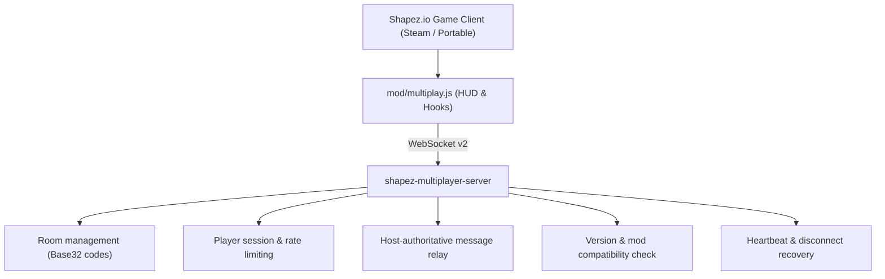

# Shapez Multiplayer Suite

[🇷🇺 Документация на русском языке (README_RU.md)](./README_RU.md) | [Apache 2.0 License](./LICENSE) | [Author & Patent Notice](./NOTICE)

A high-performance, host-authoritative multiplayer suite for [Shapez.io](https://shapez.io/) enabling seamless real-time cooperative factory building over WebSocket networks.

Compatible with both Steam and portable versions of Shapez.io across local networks, Tailscale mesh VPNs, and the public Internet.

---

## Quickstart on Any Device

### Step 1. Install Mod into Game
Run the 1-click installer (automatically copies `mod/multiplay.js` to `%APPDATA%\shapez.io\mods\`):
```powershell
.\install-mod.bat
```
*(Or manually copy `mod/multiplay.js` to your Shapez mods folder)*.

### Step 2. Start the Server
Launch the standalone server (automatically detects local & Tailscale IPs):
```powershell
.\start-server.bat
```
*(Runs precompiled `shapez-multiplayer-server.exe` if present, or falls back to `node server.js`)*.

---

## How to Play

### 1. Same-PC Local Testing
1. Run `.\start-server.bat`.
2. Launch Shapez. Click **Multiplayer** in the main menu.
3. Select **"Open current world (I am host)"**. Leave default address: `ws://127.0.0.1:7777`.
4. Copy the generated invite code (`MPZ2:...`).
5. Launch a second game instance, select **Multiplayer** -> **"Connect to friend"**, paste code and build together!

### 2. Over the Internet via Tailscale (Recommended)
No router port forwarding or static public IP required:
1. Ensure [Tailscale](https://tailscale.com/) is installed and running on both machines.
2. The host runs `.\start-server.bat`. The script displays your Tailscale IP:
   ```text
   Tailscale IP: ws://100.x.x.x:7777
   ```
3. In game, the host creates a world using `ws://100.x.x.x:7777`.
4. Send the generated `MPZ2:...` code to your friend.
5. Your friend pastes the code and connects instantly.

### 3. Local Area Network (LAN / Wi-Fi)
1. Host runs `.\start-server.bat`. Note your LAN IP (e.g., `192.168.0.x`).
2. In game, host creates room with `ws://192.168.0.x:7777`.
3. Friend connects using the generated invite code.

### 4. Dedicated Server / VPS
Run the relay server on any Linux/Windows VPS:
```bash
node server.js --port 7777 --host 0.0.0.0
```

---

## Features

* **Host-Authoritative World Model:** The host maintains canonical factory simulation and assigns all entity UIDs.
* **WebSocket v2 Protocol:** High-throughput JSON messaging with operation batching (40 ms), sequence ordering, and deduplication.
* **Synchronized Operations:**
  * Building placement & batch placement (drag-building)
  * Building deletion & batch deletion
  * Blueprints (Ctrl+C / Ctrl+V)
  * Levers & Constant Signals
  * Tech upgrades & Hub goals
* **Teammate Cursors:** Real-time mouse cursor position, color marker, and player name rendered directly on world canvas with automatic zoom scaling.
* **Live Full Resync:** Single-click "Update World" button allows clients to pull a clean snapshot from the host without restarting, flushing belt paths to eliminate floating items and refreshing map chunk caches.
* **Strict Mod & Version Validation:** Verifies matching game versions, multiplayer mod version, and installed mod sets upon handshake.
* **In-Game Chat:** Lightweight chat overlay built directly into the game HUD.

---

## Architecture



---

## Building Standalone Executable

To compile a single portable `.exe` (includes embedded Node.js runtime):

```powershell
.\build-server.ps1
```

Produces: `shapez-multiplayer-server.exe`

---

## Automated Tests

Run the test suite:
```powershell
npm test
```

All 7 core test suites verify protocol validity, deduplication, seed cache resetting, and reconnection behavior.

---

## Project Structure

```text
├── mod/
│   └── multiplay.js              # In-game client mod (2650+ lines)
├── src/
│   └── room-server.js            # Standalone WebSocket room server
├── test/
│   ├── protocol.test.js          # Protocol v2 & session tests
│   ├── mod-smoke.test.js         # Mod compatibility & deduplication tests
│   ├── game-e2e-smoke.js         # In-game E2E smoke test
│   └── exe-smoke.js              # Binary smoke test
├── server.js                     # Server CLI entry point
├── config.json                   # Server configuration defaults
├── install-mod.bat / .ps1        # 1-click mod installer
├── start-server.bat / .ps1       # 1-click server launcher
├── build-server.ps1              # Binary build script
├── LICENSE                       # Apache License 2.0
├── NOTICE                        # Sovereign Attribution & Patent Clause
└── package.json
```

---

## License & Sovereign Authorship

This project is licensed under the **Apache License 2.0**.  
See [LICENSE](./LICENSE) and [NOTICE](./NOTICE) for full terms.

**Author & Architect:** **QXIK_mIJ**.
